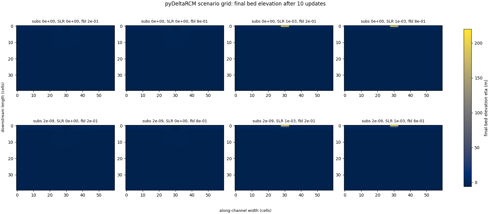

Running a scenario grid with the Preprocessor
=============================================

Here, we learn how to use the :obj:`~pyDeltaRCM.preprocessor.Preprocessor`
to run a *matrix* of model scenarios defined by a single configuration
file. Matrix expansion turns one yaml file into one job per combination
of the matrix axes, so that sweeping model parameters does not require
hand-writing (or hand-editing) one file per run.

The example grid varies three "external forcing" parameters together:
the ``subsidence_rate``, the rate of sea-level rise ``SLR``, and the
inlet bedload fraction ``f_bedload``. Each axis takes two values, so the
matrix expands to :math:`2 \times 2 \times 2 = 8` jobs, run from this
single yaml file:

.. literalinclude:: scenario_grid.yaml
   :language: yaml

The ``matrix`` mapping lists each axis and the values it takes. The
Preprocessor expands the cartesian product of these lists into eight
jobs, each receiving the shared configuration (domain size, seed,
timesteps, and so on) plus its own combination of axis values. Each job
runs in its own subdirectory of ``out_dir``, which must not already
exist for a multi-job configuration.

The runner script below executes the grid and then reads the *final
state* of every job's model directly from the Preprocessor's job list,
computing one row of metrics per job: the mean and standard deviation
of the final bed elevation, the net deposited volume (the integral of
the bed elevation change since initialization, in cubic meters), and
the timestep ``dt`` the model derived from the inlet conditions.

.. literalinclude:: scenario_grid.py
   :language: python

.. program-output:: python examples/scenario_grid.py

The runner also saves a comparison figure of the final bed elevation
``eta`` of all eight jobs, on one shared color scale:

Reading the results
-------------------

A few patterns in the table are worth calling out explicitly.

**The timestep is identical for all jobs.** ``dt`` is not a free
parameter: it is derived from the inlet conditions (inlet velocity,
depth, width, and sediment concentration) and the grid spacing, so the
three axes varied here do not move it. This is also why the grid
deliberately excludes the inlet axes (``u0``, ``h0``, ``N0_meters``):
``Qw0``, ``Qs0``, and ``dt`` are all *derived* from them, so sweeping an
inlet condition changes the water discharge, the sediment supply, *and*
the timestep at once. That conflates several effects per axis; if you
want to sweep inlet conditions, be prepared to interpret (or
parameterize away) the resulting change in ``dt``.

**Deposit volume responds to the bedload fraction.** At both sea-level
settings, ``f_bedload = 0.75`` deposits more sediment than ``0.25``.
Bedload-dominated parcels deposit near the inlet, where the flow
enters the domain, while the suspended fraction is carried farther
into the basin before settling.

**The subsidence axis is a cautionary tale.** At the rate used here
(:math:`2 \times 10^{-9}` m/s) and a run of only ten updates, total
subsidence is a fraction of a micrometer: far below the bed elevation
changes caused by the routing itself. The differences between the
``subsidence_rate = 0`` and ``2e-09`` rows are therefore *not* the
subsidence signal -- they are the chaotic divergence of two otherwise
identical runs after a tiny perturbation to the bed. If you need to
measure the effect of subsidence (or any slow forcing), widen the rate
or the run duration until the signal exceeds this chaotic noise floor;
see :doc:`subsidence_region` for the mechanics of the subsidence
implementation.

.. note::

   The parameter values are chosen to keep the docs build fast, not for
   geomorphic realism: the domain is small (2 km x 3 km at 50 m
   resolution), the run is short, and the sea-level rise rate is many
   orders of magnitude above natural rates. Treat the grid as a
   template -- widening it to real scenarios is a one-file change to
   the yaml.

.. note::

   The example runs the grid *serially*, which keeps every model object
   in the runner process (so their final states can be read directly)
   and pays the just-in-time compilation of the model kernels only
   once. For larger grids, setting ``parallel: True`` (or an integer
   worker count) in the yaml runs the jobs in parallel worker
   processes; note that each worker then compiles the kernels on its
   own, which dominates the runtime of small grids like this one.
